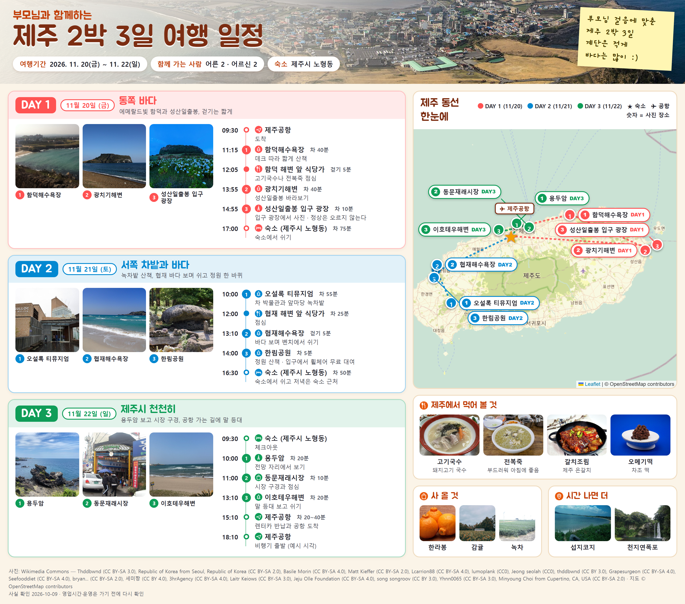
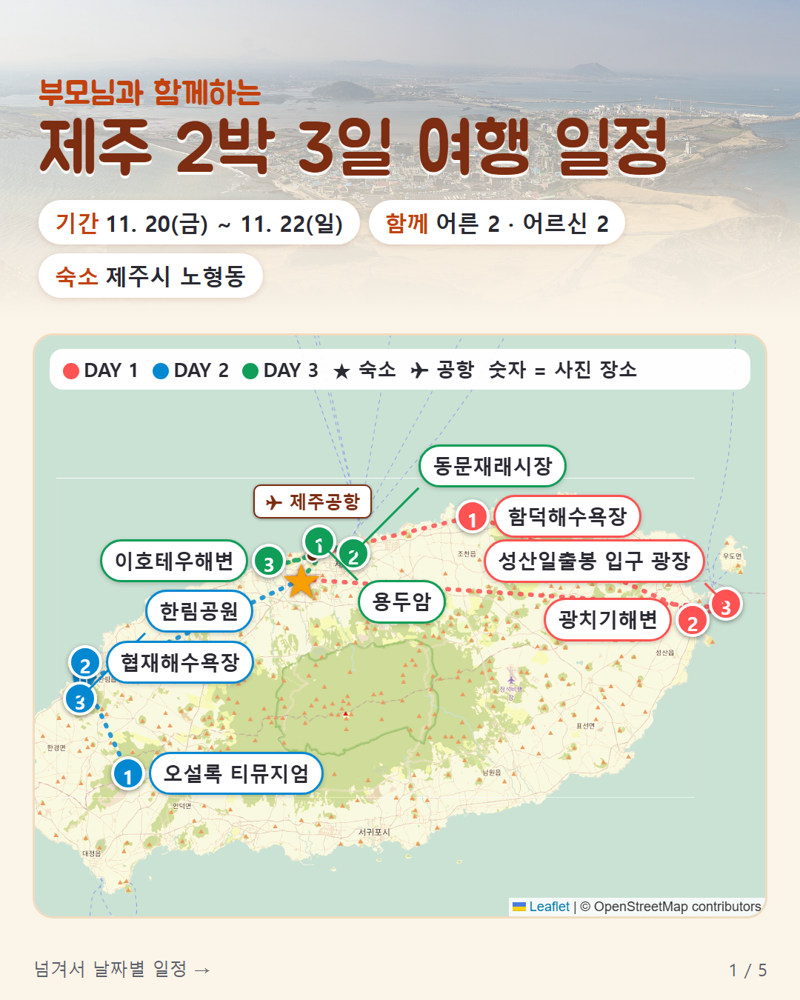
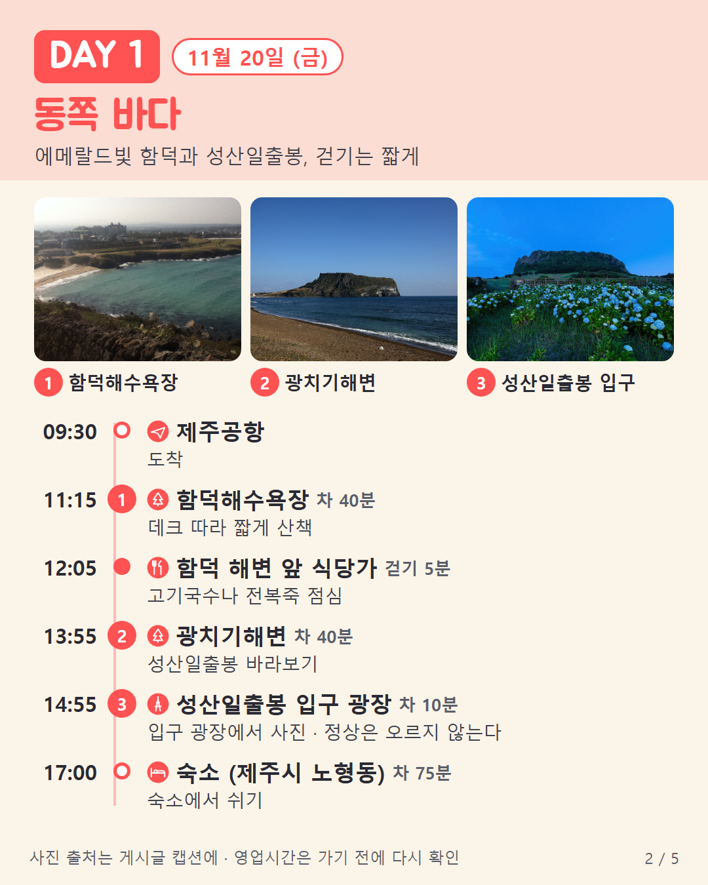
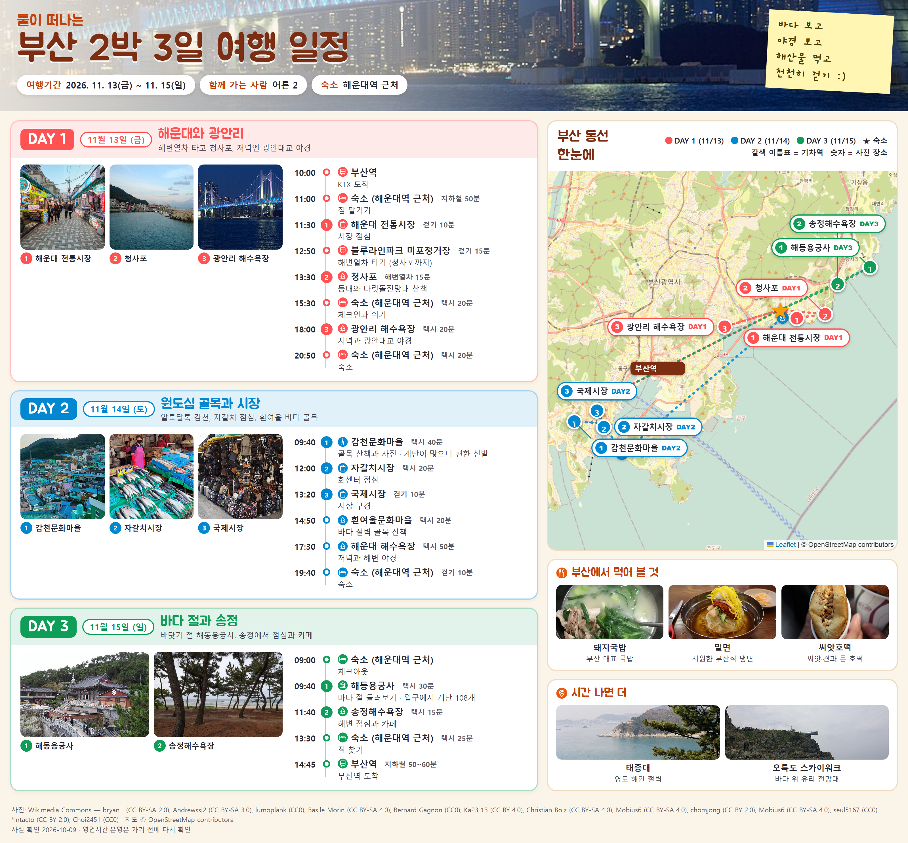

# 파워J 여행 일정 — 일정 파일 하나로 한 장 그림·인스타 넘김·폰 웹앱·지도·시트



| 인스타 넘김(1080×1350) | | 다른 샘플 |
|---|---|---|
|  |  |  |

넘김 그림 속 사진 출처는 [docs/CREDITS.md](docs/CREDITS.md)에 있습니다.

여행 계획은 같은 사실이 여러 곳에 적히면서 틀어집니다. 포스터에는 09:00 도착인데 지도에는 귀국이 두 번 있는 식입니다. 그래서 이 도구는 **모든 사실을 여행 파일(YAML) 하나에 한 번만** 적습니다. 결과물은 전부 그 파일 하나에서 만들어집니다.

- **한 장 그림**: 날짜별 사진·시간표·지도 (가로 PNG)
- **인스타 넘김**: 표지+지도, 날짜마다 한 장, 먹을 것 (1080×1350 PNG)
- **폰 웹앱**: 인터넷 없이 열리는 HTML 한 파일
- **구글 내 지도용 KML**과 **구글 시트용 xlsx**

만들기 전에 **J 검사기**가 먼저 틀린 곳을 잡습니다. 잡는 것은 이렇습니다.

- 영업시간 전 도착, 휴무일 방문, 공휴일 다음 날 휴무
- 나이 제한, 예약 안 한 시간 지정 입장권
- 이동 여유 부족, 같은 사실이 다르게 적힌 곳

일정은 **여행의 기본 순서**로 채웁니다: ① 교통편 → ② 숙소(예산 안) → ③ 날씨 → 날짜별 알맹이(하루 3~6곳, 이동 시간) → 준비물. 여행 파일의 `basics` 칸에 적으면 넘김 2·3장(교통편·숙소 / 날씨·준비물)이 생깁니다. 1박 2일을 처음부터 짜는 데 AI 쪽에서 약 37분 걸렸습니다(장소 수에 따라 달라요).

## 코딩 없이 써 보기

설치가 어렵다면 아래 상자를 복사해 쓰는 AI(챗GPT·클로드·제미나이)에 붙여 넣으세요. 같은 순서로 한 단계씩 물어보며 글로 된 일정을 짜 줍니다(그림·지도 파일은 이 도구를 설치해야 나와요).

```text
■ 내 여행 일정 도우미

■ 너에게 부탁
나는 함께 가는 사람의 걷기 조건과 여행 날짜에 맞춰 무리 없는 여행 일정을 짜고 싶어. 이 파일대로 한 단계씩 도와줘. 한 번에 하나만 묻고, 내가 답하기 전에는 다음 단계로 넘어가지 마. 모르는 정보는 짐작으로 채우지 말아 줘.

■ 목표
쉬는 시간과 돌아오는 길까지 들어간 날짜별 일정을 만든다. 찾은 정보에는 출처와 확인한 날짜를 붙이고, 피곤할 때 뺄 곳을 표시한다.

■ 시작하기 전에 나에게 물어볼 질문
1. 누구와 가는 여행인가요? 이름과 나이 대신, 오래 걷기, 계단, 음식에서 생각할 조건을 알려 주세요.
2. 어디로 며칠 가나요? 정해진 날짜와 도착, 출발 시각이 있으면 함께 알려 주세요.
3. 꼭 가고 싶은 곳이 있나요? 아직 없으면 없다고 답해도 됩니다.

■ 단계
1단계. 교통편: 오가는 방법과 시각, 걸리는 시간, 예매 시기를 정리한다.
2단계. 숙소: 예산 안에서 묵을 동네를 2~3곳 비교하고 하나를 추천한다.
3단계. 날씨: 그 달 평년 기온과 비 오는 날 대안을 적는다.
4단계. 장소 후보를 고르고, 웹을 찾을 수 있으면 공식 안내에서 영업시간·휴무·입장 마감·예약을 찾아 출처와 확인한 날짜를 붙인다. 찾지 못하면 '확인 필요'로 남긴다.
5단계. 날짜별로 방문 순서, 머무는 시간, 이동 시간, 식사와 쉬는 시간을 적는다. 피곤할 때 뺄 곳도 표시한다.
6단계. 날씨와 일정에 맞춘 준비물을 적고, 글로 된 한 장 일정을 보여 준다.

■ 넣지 말 것
- 여권번호, 카드번호, 집 주소
- 아이 이름과 나이(조건만 적는다)
```

## 설치 (처음 한 번, 몇 분)

1. 이 저장소를 받습니다.
2. `trip-planner` 폴더를 Claude Code 스킬 폴더에 복사합니다. 맥·리눅스는 `~/.claude/skills/`, 윈도우는 `C:\Users\<내 이름>\.claude\skills\` 입니다.
3. 파이썬 3.10 이상에서 아래를 한 번 돌립니다. 마지막 줄은 그림을 굽는 브라우저를 받아서 몇백 MB, 몇 분 걸립니다.

```bash
pip install pyyaml openpyxl playwright
playwright install chromium
```

설치가 끝나면 Claude Code 에서 **"부모님이랑 제주 2박 3일 일정 짜줘"** 처럼 말하면 됩니다. 스킬이 모자란 것만 묻고, 여행 파일을 쓰고, 검사한 뒤 결과물을 만듭니다.

## 직접 돌려 보기 (샘플)

윈도우에서 한글이 깨지면 먼저 `set PYTHONIOENCODING=utf-8`(Git Bash 는 `export PYTHONIOENCODING=utf-8`)를 한 줄 넣으세요.

```bash
cd trip-planner
python scripts/check_trip.py examples/parents-jeju.yaml        # J 검사기
python scripts/build_poster.py examples/parents-jeju.yaml out poster
python scripts/build_carousel.py examples/parents-jeju.yaml out
python scripts/build_all.py examples/parents-jeju.yaml out      # 웹앱·지도·시트
```

샘플에는 사진 파일이 들어 있지 않아서, 처음 돌리면 **사진 칸이 빈 그림**이 나옵니다. 정상입니다. 사진은 따로 받습니다.

- **해외**: `fetch_photos.py` 가 위키미디어 공용에서 자유 라이선스 사진만 고릅니다(CC BY·CC BY-SA·CC0·퍼블릭 도메인).
- **국내**: `fetch_kto.py` 가 한국관광공사 관광사진 API(공공누리 제1유형)에서 받습니다. 공공데이터포털에서 받은 키를 환경변수 `DATA_GO_KR_KEY` 에 넣으면 됩니다.

검색 결과가 엉뚱한 장소일 때가 있으니, **받은 사진은 꼭 눈으로 확인하세요.** 사진 작가와 라이선스는 한 장 그림 아래에 자동으로 적힙니다. 넘김은 자리가 좁아 출처를 게시글 본문(캡션)에 따로 적어야 합니다.

## 샘플에 대해

`examples/` 의 여행 넷(제주·부산·오사카·도쿄)은 **지어낸 여행자**와 예시 숙소로 만든 것입니다. 장소·영업시간·요금은 2026-10 공개 자료와 대조했지만 바뀔 수 있으니 **가기 전에 다시 확인하세요.**

## 쓴 것과 표기

- **지도**: © OpenStreetMap contributors, [Leaflet](https://leafletjs.com)(BSD-2)
- **글꼴**: Google Fonts의 Jua·Gaegu, 웹앱의 IBM Plex Sans KR·Mono (모두 SIL OFL)
- **지도 조각**: tile.openstreetmap.org 는 가벼운 개인 사용만 허용합니다. 많이 쓰려면 다른 지도 조각 서비스로 바꾸세요.
- **관광공사 사진**: 공공누리 제1유형(출처 표시). 그림 아래에 "한국관광공사(공공누리 1유형) — 사진가"로 자동으로 적힙니다.
- **샘플 그림 속 사진**: Wikimedia Commons 의 각 작가. 온전한 작가·라이선스·원본 주소는 [docs/CREDITS.md](docs/CREDITS.md)에 있습니다.
- 결과물의 영업시간·가격은 "확인일" 기준입니다.

## 라이선스

**코드만 MIT** 입니다([LICENSE](LICENSE)). 사진은 [docs/CREDITS.md](docs/CREDITS.md)에 적힌 각 사진의 라이선스를 따릅니다.
